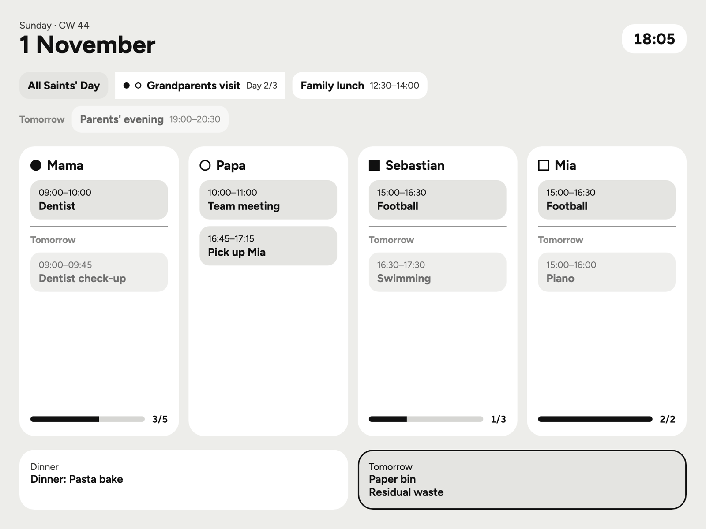
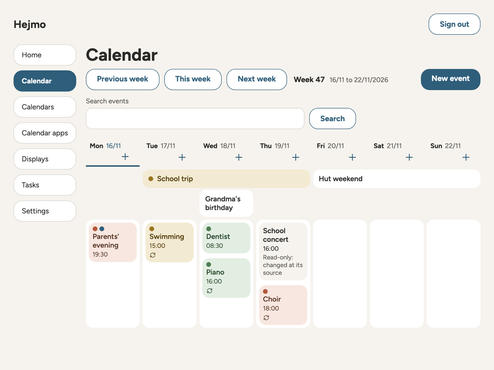

# Hejmo

**Your family's day in one place, under your own control.**

Hejmo (Esperanto for "home") is a self-hosted, open-source family organizer. A small box at home, such as a Raspberry Pi, collects your family's calendars, tasks, lists and meal plan and shows today on a wall display, tablet or phone: one column per person, so everyone sees at a glance what is on, what is done and what comes tomorrow. All data stays at home.


<sub>The family view (start screen of every display), landscape. Design preview with sample data.</sub>

## What it does

- **Family view on the wall:** one column per person with today's events, a progress bar for today's tasks, all-day events and holidays on top, and tiles for today's meals and tomorrow's waste collection. Updates live, landscape or portrait.
- **Calm on E-Ink:** every screen also works in black and white; people are told apart by marker shapes instead of colours.
- **Your calendars, synced:** iCloud and any CalDAV server (two-way), Google Calendar, ICS subscriptions such as school or waste collection calendars. Your phones' calendar apps can subscribe to the box in turn.
- **Web interface and phones:** week calendar, tasks, lists and meal plan in the browser; a phone is paired by QR code. Children get their own simple view.
- **Private by design:** no subscription, no telemetry, no mandatory cloud. HTTPS with the box's own certificate authority or a free public name, sign-in with a passkey, or password and one-time codes.
- **Open:** open standards (CalDAV, iCalendar), an open REST API, AGPL-3.0, developed in Europe. Open to your own AI assistant, without built-in AI.

<table>
<tr>
<td width="50%"></td>
<td width="50%"></td>
</tr>
<tr>
<td><sub>Black and white for E-Ink displays</sub></td>
<td><sub>Week calendar in the web interface</sub></td>
</tr>
</table>

> **Status:** early development. Not ready for everyday use yet; the first public version will be **0.1**.

## Feature roadmap

✅ done · 🚧 in progress · ⏳ planned

### 0.1: first public version

| Area | Features | Status |
|---|---|---|
| Box and setup | Docker image for x86_64 and arm64, setup wizard, HTTPS (own certificate authority or a free deSEC name with Let's Encrypt) | ✅ |
| People and sign-in | Parents and children, roles, password with one-time codes, display PIN, REST API with scoped tokens | ✅ |
| | Recovery codes for one-time codes, people page | 🚧 |
| | Passkeys (sign in with fingerprint, face or PIN; they work under the box's name, never by IP address) | ✅ |
| Calendar | Series with "this / this and following / all", multi-day events, public holidays for Germany, Austria and Switzerland, search, subgroups | ✅ |
| Sync | ICS subscriptions, iCloud and CalDAV (read), box as CalDAV server for your calendar apps, iOS profile | ✅ |
| | Writing back to iCloud and CalDAV, Google Calendar | 🚧 |
| Displays | Pairing by QR code, family view in colour and black and white, personal view, weather and time, live updates | ✅ |
| | Portrait layout, quiet mode at night, themes by sunrise and sunset, home location | 🚧 |
| Web interface and phones | Frame, shared form patterns, phone web app, children's phones | ✅ |
| | Week calendar with editing, choosing calendars, settings hub | 🚧 |
| Everyday | Simple tasks | ✅ |
| | Lists, shared meal plan, meal tile, tasks on the display, waste collection reminder | ⏳ |
| For children | Stars with a star log | 🚧 |
| | Routines with ready-made templates, subtasks | ⏳ |
| Connect | Tasks as VTODO lists in your calendar apps, MCP server for your own AI assistant (off by default) | ⏳ |
| Operations | Release pipeline with signed images, install script and guide, auto-update at night with rollback, security checks, resource measurement for the Raspberry Pi | ✅ |

### Later

| Release | Content |
|---|---|
| **0.2 and later** | Outlook sync, photo screensaver, brightness control, choosing people per display |
| **V2 / V3** | Rewards, streaks and badges for stars; leave-the-house reminder per person; box as CardDAV server; school, childcare and logistics; shared-custody model and multiple households (see the specification) |

The plan in detail: [ADR 0018](docs/adr/0018-path-to-0-1.md) (path to 0.1) and the [specification](docs/spec.md).

## Documentation

- Install guide: [English](docs/install.md), [Deutsch](docs/install.de.md) (Raspberry Pi OS: one command)
- [Specification](docs/spec.md): features, data model, acceptance criteria, design
- [Architecture decision records](docs/adr/): decisions that refine or override the specification
- [Design system](DESIGN.md) and [glossary](GLOSSARY.md)

## Development

Requirements: Go (see `go.mod`), Docker.

```bash
go test ./...          # run all tests
go run ./cmd/hejmo     # start the box on http://localhost:8080
docker compose up      # run the container
```

Health check: `GET /healthz` returns `{"status":"ok"}`. Data lives in `HEJMO_DATA_DIR` (default `/data`, SQLite).

**HTTPS** (ADR 0014): the box serves everything over HTTPS; HTTP only redirects. The setup wizard starts over HTTP, creates the box's own certificate authority (name-constrained to the box) and only then asks for a password. Download the iOS profile or certificate at `/ca`. Ports are configurable in Compose through `HEJMO_HTTP_PORT` (default 80) and `HEJMO_HTTPS_PORT` (default 443); keys live in `HEJMO_DATA_DIR/tls`. The wizard can instead set up a **public name**: a free deSEC `dedyn.io` name (or an own domain at deSEC) pointing to the box's LAN address, with a publicly trusted certificate (Let's Encrypt, or Actalis) obtained and renewed by the box through DNS-01, so phones need no CA installed. The DNS token is stored encrypted; its key is `HEJMO_DATA_DIR/secret.key`, or the file named by `HEJMO_SECRET_KEY_FILE` such as a Docker secret (back it up with the database; if it is lost, the box keeps serving the stored certificate over HTTPS and warns you until it expires; restore the key file from your backup). If your router blocks the name (FRITZ!Box DNS rebind protection), the wizard shows how to allow it, or lets you use the box's own certificate authority instead. Without Docker, `go run ./cmd/hejmo` listens on HTTP 8080 and HTTPS 8443 (`HEJMO_ADDR`, `HEJMO_HTTPS_ADDR`, `HEJMO_PUBLIC_HTTPS_PORT`). `HEJMO_PUBLIC_HTTPS_PORT` is the port clients reach HTTPS on, used in redirects and links; if unset it is the port of `HEJMO_HTTPS_ADDR`. Set it only when a port mapping differs (Compose sets it from `HEJMO_HTTPS_PORT`).

Calendar passwords (iCloud app-specific passwords and other CalDAV logins) are stored encrypted with AES-256-GCM. The key is generated on first start in `/data/secret.key` (mode 0600); `HEJMO_SECRET_KEY_FILE` points to another file, such as a Docker secret. This protects a leaked database file or backup on its own. It does **not** protect a leaked data volume, because the key sits next to the database unless you move it. Keep the key with your backup if you want to restore connections; without it, connect the calendars again.

On first start the box opens the **setup wizard**: HTTPS, home location (town and state/canton), first parent account with password and one-time codes (TOTP from any authenticator app, for example Aegis or FreeOTP), and the parent PIN for displays. The box then shows 10 recovery codes, each valid once in place of a one-time code.

**Lost your one-time codes?** Use a recovery code, or ask another parent to reset them under *My account* in the settings. As the last way back, run this on the box; it resets the account's one-time codes and signs it out of browsers, and the next sign-in sets up new ones:

```bash
docker compose exec hejmo /hejmo reset-otp <username>
```

The reset is logged as `one-time codes reset` in the box's log (`docker compose logs hejmo`).

## API

The REST API lives under `/api/v1`; its OpenAPI description is served at `/api/v1/openapi.yaml` ([source](api/openapi.yaml)). Authenticate with a bearer token (`Authorization: Bearer hejmo_…`) created via `POST /api/v1/tokens`. Tokens are limited by scopes such as `read`, `write`, `lists` or `events:read`. `read` and `write` exclude health data (diet and allergies); that needs the explicit scope `health` or `health:read`.

Calendar endpoints (work package 3):

| Endpoint | Purpose |
|---|---|
| `GET /events?from=…&to=…[&person=…]` | Occurrences with series expanded; with `person` only what that person's view shows |
| `POST /events` | Create an event or a series (`rrule`, e.g. `FREQ=WEEKLY;BYDAY=MO`) |
| `PATCH` / `DELETE /events/{id}?occurrence=…&scope=this\|following\|all` | Change or delete occurrences of a series |
| `GET /holidays?from=…&to=…` | Public holidays of the home state or canton |
| `GET /search?q=…` | Full-text search |
| `GET/POST /groups`, `GET /calendars` | Subgroups and calendars with their audience |

Development is strictly test-driven: every acceptance criterion starts as a failing test.

## Contributing

Contributions are welcome. Please read [CONTRIBUTING.md](CONTRIBUTING.md); every commit needs a DCO sign-off.

## License

[GNU Affero General Public License v3.0](LICENSE)
