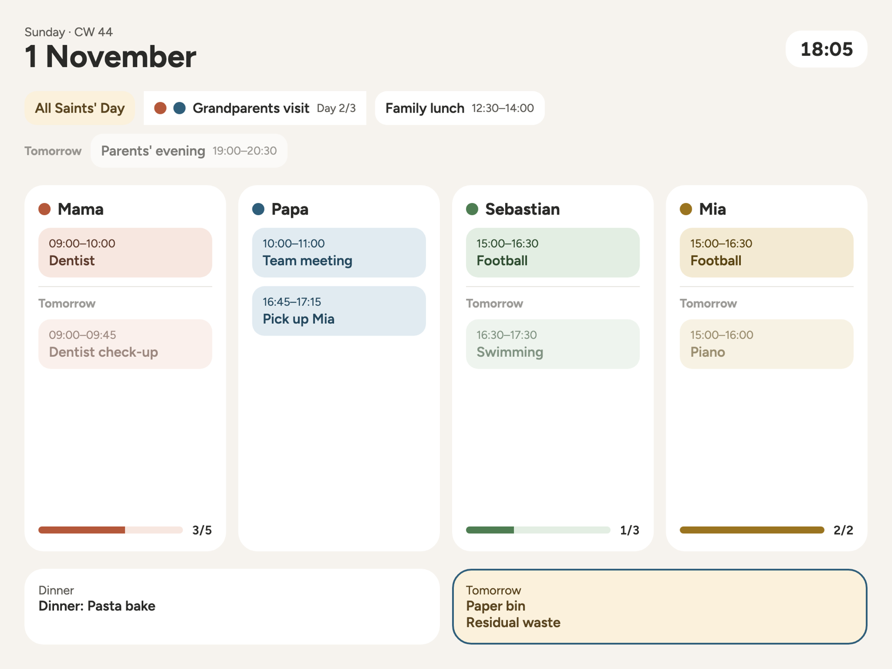

# Hejmo

**Your household's day in one place, under your own control.**

Hejmo (Esperanto for "home") is a self-hosted, open-source family organizer. A small **box** at home, written in Go with SQLite, collects the household's calendars, tasks, lists and meal plan and shows today on **displays**: wall-mounted E-Ink or normal screens, plus personal devices. The **family view** has one column per person, so everyone sees at a glance what is on, what is done and what comes tomorrow. All data stays at home.



<sub>The family view (start screen of every display), landscape. Design preview with sample data.</sub>

> **Status (17/11/2026): pre-release.** No version has been published yet. Until the first public release, **0.1**, builds from `main` are previews: not for everyday use, and data may need to be set up again. See the [roadmap](#roadmap) and the [status notes](#status-notes).

## What works in `main` today

- **Family view and displays:** one column per person with today's events, task progress, the family strip for all-day events and public holidays, weather and time for the home location (picked from a place list on the box), and tiles for today's meals and tomorrow's waste collection. Live updates, landscape and portrait, black-and-white mode with marker shapes, themes by sunrise and sunset, a photo screensaver with albums, a sync notice and a personal view per person. Displays are paired by QR code.
- **Quiet mode and brightness:** a night page, and through the kiosk adapter (FreeKiosk, [setup](docs/freekiosk.md)) brightness by sunrise and sunset, off or dimmed at night, per display. Front light on E-Ink is experimental, see [status notes](#status-notes).
- **Calendar:** events and series with the edit scopes this, this and following, all; multi-day events, public holidays for Germany, Austria and Switzerland, search, subgroups and audiences. The web interface has a week calendar with editing and a page to choose calendars.
- **Calendar sync:** ICS subscriptions and two-way sync with iCloud or any CalDAV server (fast sync-collection and `.well-known` discovery). The box is itself a CalDAV server for your calendar apps, with an iOS profile and one task list per person (VTODO). Nothing syncs through a cloud of ours.
- **Tasks:** simple tasks, routines with ready-made routine templates, subtasks, stars with a star log, and task progress per person on the display.
- **Lists and meals:** shared lists in the web interface and on the display, with an article library (own articles and pictures), quantities with units by country and a tile view for children; diet and allergies per person with allergen warnings; a shared meal plan with meal plan templates; waste collection reminder; day notes.
- **People and personal devices:** parents and children, roles, invitations for a second parent, personal devices (phones, tablets) paired by QR code (children get their own simple view and cannot sign out), re-pairing a personal device for another person in one step, a clear page when a device is no longer paired, parents can end a lost device's session. Theme chooser (light, dark, automatic) for everyone; settings pages with breadcrumbs. German and English interface.
- **Sign-in and HTTPS:** setup wizard, HTTPS "only in the home network" with the Box CA or a public name (free deSEC name, or your own domain at Cloudflare, deSEC, Hetzner or INWX, with Let's Encrypt), a router name in the box certificate and a guide for reaching home by VPN, passkeys, password with one-time codes and recovery codes (PDF download), parent PIN for displays.
- **Offline mode:** one switch stops every connection from the box to the outside; the page "Connections to the outside" shows each one, its last contact and every refused attempt.
- **Open interfaces:** REST API under `/api/v1` with scoped tokens ([OpenAPI](api/openapi.yaml)), and an MCP server for your own AI assistant, off by default ([guide](docs/mcp.md)). Hejmo has no built-in AI.
- **Operations:** Docker image for x86_64 and arm64, install script for Raspberry Pi OS, release pipeline with signed images, auto-update at night with rollback, security checks and resource measurement in CI.

<table>
<tr>
<td width="50%"></td>
<td width="50%"></td>
</tr>
<tr>
<td><sub>Black and white for E-Ink displays</sub></td>
<td><sub>Week calendar in the web interface</sub></td>
</tr>
</table>

## Roadmap

The plan is in [ADR 0002](docs/adr/0002-goals-and-release-model.md) (release model), [ADR 0018](docs/adr/0018-path-to-0-1.md) (path to 0.1), [ADR 0019](docs/adr/0019-lists-article-library-and-diets.md) (lists) and [ADR 0020](docs/adr/0020-versions-0-2-and-0-3.md) (0.2 and 0.3). All tickets: [milestones](https://github.com/hejmo-home/hejmo/milestones).

### 0.1: first public release

[Milestone 0.1](https://github.com/hejmo-home/hejmo/milestone/1): 43 tickets done, 3 open.

**Done:** everything listed above except the open items below, including the install script and [install guide](docs/install.md), release pipeline, auto-update with rollback, passkeys, routines, stars, subtasks, VTODO export, MCP server and diet and allergies per person.

**Still open:**

- Google Calendar connection ([#18](https://github.com/hejmo-home/hejmo/issues/18)) with its relay page ([#232](https://github.com/hejmo-home/hejmo/issues/232)).
- One choice page for all ways to add a calendar ([#231](https://github.com/hejmo-home/hejmo/issues/231)).

### 0.2

[Milestone 0.2](https://github.com/hejmo-home/hejmo/milestone/2), contents per ADR 0020:

- CalDAV: sync-collection and `.well-known` discovery ([#54](https://github.com/hejmo-home/hejmo/issues/54), merged)
- Public name: more DNS providers, Cloudflare, INWX and Hetzner ([#57](https://github.com/hejmo-home/hejmo/issues/57), merged); VPN guide and router name ([#216](https://github.com/hejmo-home/hejmo/issues/216), merged)
- API access for displays: open a pairing and read its state ([#61](https://github.com/hejmo-home/hejmo/issues/61), merged)
- Theme chooser for everyone ([#125](https://github.com/hejmo-home/hejmo/issues/125), merged)
- Sync lists with Apple Reminders ([#167](https://github.com/hejmo-home/hejmo/issues/167))
- Articles always on the list ([#168](https://github.com/hejmo-home/hejmo/issues/168))
- Outlook calendar sync ([#177](https://github.com/hejmo-home/hejmo/issues/177))
- Photo screensaver for displays ([#178](https://github.com/hejmo-home/hejmo/issues/178), merged)
- Display brightness control ([#179](https://github.com/hejmo-home/hejmo/issues/179))
- Choose people and blocks per display, full layouts ([#180](https://github.com/hejmo-home/hejmo/issues/180))
- Offline mode ([#201](https://github.com/hejmo-home/hejmo/issues/201), merged); uploading an update file ([#221](https://github.com/hejmo-home/hejmo/issues/221))
- family view at 375 px ([#208](https://github.com/hejmo-home/hejmo/issues/208))

### 0.3

[Milestone 0.3](https://github.com/hejmo-home/hejmo/milestone/3), contents per ADR 0020, details decided in [ADR 0021](docs/adr/0021-version-0-3-recipes-rewards-address-book.md):

- Recipes linked to the meal plan and shopping list, with a starter collection of 200 dishes in German and English ([#193](https://github.com/hejmo-home/hejmo/issues/193))
- Star rewards: catalogue, streaks and badges ([#194](https://github.com/hejmo-home/hejmo/issues/194))
- Box as address book, a CardDAV server ([#195](https://github.com/hejmo-home/hejmo/issues/195))

Later: Immich as a photo source for the screensaver (V3).

## Status notes

- **Raspberry Pi: tested in emulation only.** CI runs the box in a container limited like a Raspberry Pi (1 CPU, 1 GB) on an arm64 machine. Nobody has confirmed it on real hardware yet ([measurements](docs/install/hardware.md)).
- **E-Ink and kiosk functions are experimental, not yet tested on E-Ink devices.** Black and white on real E-Ink, the ghosting reload and the front light in quiet mode are built and tested against a fake kiosk adapter. Everything also works on a normal screen such as an iPad.
- **Install via Docker Compose** on any Linux (`compose.yaml` in this repository), or with the install script on Raspberry Pi OS. The [install guide](docs/install.md) ([Deutsch](docs/install.de.md)) is a draft until 0.1; auto-update installs published versions only, never previews.

## Why a separate project

Other open-source family organizers exist. Before starting, we looked at OpenSkyLight (a Windows desktop app) and Hearthboard (an Android app, GPL-3.0); neither fits a box with displays. The closest one is [Yuvomi](https://github.com/ulsklyc/yuvomi) (MIT), which covers more areas than Hejmo does today, such as budget and documents. We compared the two closely and decided to keep building Hejmo on its own:

- **Different centre.** Hejmo is built around a box at home and the displays on the wall: E-Ink, kiosk mode, one family view. These are the core of Hejmo. Adding them to another project would change that project's direction.
- **Different foundations.** Hejmo is a single small Go program with SQLite, made to run on a Raspberry Pi. Every connection to the outside goes through [one tested door](docs/adr/0024-offline-mode-and-the-one-door-to-the-outside.md). Building on a Node.js codebase would mean either giving up these guarantees or rewriting most of it.
- **Different license.** Hejmo is AGPL-3.0, so improvements to a hosted copy stay open as well.

We still learn from Yuvomi. Its public change history shows which problems real households ran into, and several of them are now acceptance criteria in Hejmo's tickets. If we port a small piece of its MIT-licensed logic, the code names the source.

## Documentation

- Install guide: [English](docs/install.md), [Deutsch](docs/install.de.md) (draft until 0.1); [hardware and measurements](docs/install/hardware.md)
- [AI assistants (MCP)](docs/mcp.md) and [threat model](docs/security/threat-model.md)
- [Specification](docs/spec.md): features, data model, acceptance criteria, design
- [Architecture decision records](docs/adr/): decisions that refine or override the specification
- [Design system](DESIGN.md) and [glossary](GLOSSARY.md)

## Development

Requirements: Go (see `go.mod`), Docker.

```bash
go test ./...          # run all tests
go run ./cmd/hejmo     # start the box on port 8080
docker compose up      # run the container
```

The box answers at [localhost:8080](http://localhost:8080) (HTTP) when run this way. Health check: `GET /healthz` returns `{"status":"ok"}`. Data lives in `HEJMO_DATA_DIR` (default `/data`, SQLite).

**HTTPS** (ADR 0014): the box serves everything over HTTPS; HTTP only redirects. The setup wizard starts over HTTP, creates the box's own certificate authority (name-constrained to the box) and only then asks for a password. Download the iOS profile or certificate at `/ca`. Ports are configurable in Compose through `HEJMO_HTTP_PORT` (default 80) and `HEJMO_HTTPS_PORT` (default 443); keys live in `HEJMO_DATA_DIR/tls`. The wizard can instead set up a **public name**: a free deSEC `dedyn.io` name, or your own domain at Cloudflare, deSEC, Hetzner or INWX, pointing to the box's LAN address, with a publicly trusted certificate (Let's Encrypt, or Actalis) obtained and renewed by the box through DNS-01, so devices need no CA installed. The DNS credentials (a token, or for INWX user name, password and the two-factor secret if you use one) are stored encrypted; its key is `HEJMO_DATA_DIR/secret.key`, or the file named by `HEJMO_SECRET_KEY_FILE` such as a Docker secret (back it up with the database; if it is lost, the box keeps serving the stored certificate over HTTPS and warns you until it expires; restore the key file from your backup). If your router blocks the name (FRITZ!Box DNS rebind protection), the wizard shows how to allow it, or lets you use the box's own certificate authority instead. Without Docker, `go run ./cmd/hejmo` listens on HTTP 8080 and HTTPS 8443 (`HEJMO_ADDR`, `HEJMO_HTTPS_ADDR`, `HEJMO_PUBLIC_HTTPS_PORT`). `HEJMO_PUBLIC_HTTPS_PORT` is the port clients reach HTTPS on, used in redirects and links; if unset it is the port of `HEJMO_HTTPS_ADDR`. Set it only when a port mapping differs (Compose sets it from `HEJMO_HTTPS_PORT`).

**Outlook** (ADR 0020, #177): parents connect a Microsoft account (Outlook.com, Hotmail, Live, Microsoft 365) by device code: they sign in at Microsoft on any phone or computer, the box never sees the password and holds no secret (a public client). Events sync through Microsoft Graph by delta every 5 minutes; invitations with attendees stay read-only. The Hejmo project's Microsoft app registration is a build value (`docker build --build-arg OUTLOOK_CLIENT_ID=...`) or `HEJMO_OUTLOOK_CLIENT_ID`; it is not created yet, so until then a family enters its own app ID under "More options" on the connect page. The connection goes to `login.microsoftonline.com` and `graph.microsoft.com` only (threat model T25).

Calendar passwords (iCloud app-specific passwords and other CalDAV logins) and the Outlook sign-in token are stored encrypted with AES-256-GCM. The key is generated on first start in `/data/secret.key` (mode 0600); `HEJMO_SECRET_KEY_FILE` points to another file, such as a Docker secret. This protects a leaked database file or backup on its own. It does **not** protect a leaked data volume, because the key sits next to the database unless you move it. Keep the key with your backup if you want to restore connections; without it, connect the calendars again.

On first start the box opens the **setup wizard**: HTTPS, home location (town and state/canton), first parent account with password and one-time codes (TOTP from any authenticator app, for example Aegis or FreeOTP), and the parent PIN for displays. The box then shows 10 recovery codes, each valid once in place of a one-time code.

**Lost your one-time codes?** Use a recovery code, or ask another parent to reset them under *My account* in the settings. As the last way back, run this on the box; it resets the account's one-time codes and signs it out of browsers, and the next sign-in sets up new ones:

```bash
docker compose exec hejmo /hejmo reset-otp <username>
```

The reset is logged as `one-time codes reset` in the box's log (`docker compose logs hejmo`).

## API

The REST API lives under `/api/v1`; its OpenAPI description is served at `/api/v1/openapi.yaml` ([source](api/openapi.yaml)). Authenticate with a bearer token (`Authorization: Bearer hejmo_…`) created via `POST /api/v1/tokens`. Tokens are limited by scopes such as `read`, `write`, `lists` or `events:read`. `read` and `write` exclude health data (diet and allergies); that needs the explicit scope `health` or `health:read`.

Calendar endpoints:

| Endpoint | Purpose |
|---|---|
| `GET /events?from=…&to=…[&person=…]` | Occurrences with series expanded; with `person` only what that person's view shows |
| `POST /events` | Create an event or a series (`rrule`, e.g. `FREQ=WEEKLY;BYDAY=MO`) |
| `PATCH` / `DELETE /events/{id}?occurrence=…&scope=this\|following\|all` | Change or delete occurrences of a series |
| `GET /holidays?from=…&to=…` | Public holidays of the home state or canton |
| `GET /search?q=…` | Full-text search |
| `GET/POST /groups`, `GET /calendars` | Subgroups and calendars with their audience |

Development is strictly test-driven: every acceptance criterion starts as a failing test.

## Contributing

Contributions are welcome. Please read [CONTRIBUTING.md](CONTRIBUTING.md); every commit needs a DCO sign-off.

## License

[GNU Affero General Public License v3.0](LICENSE)
